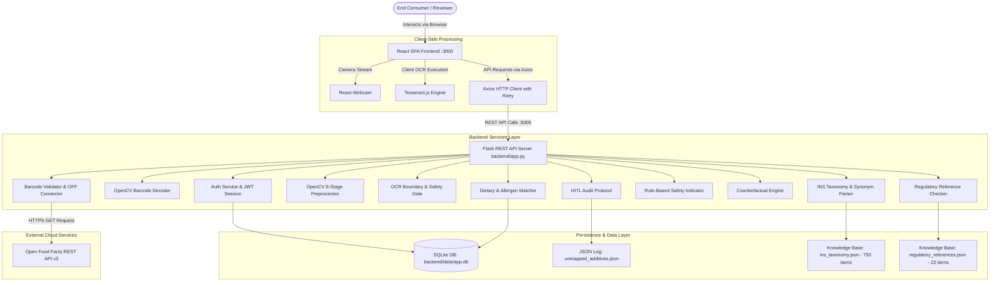
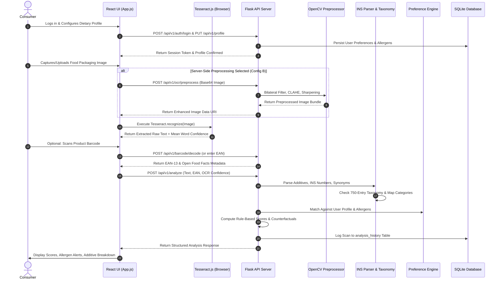
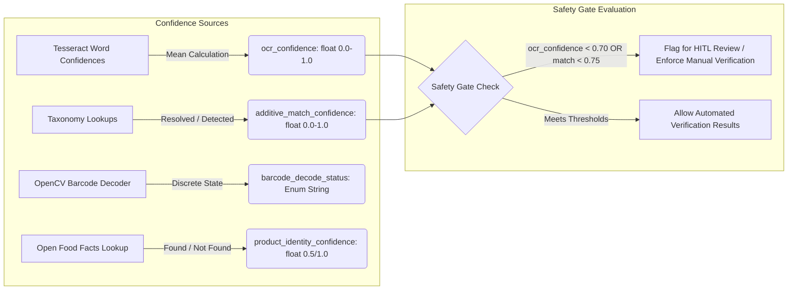
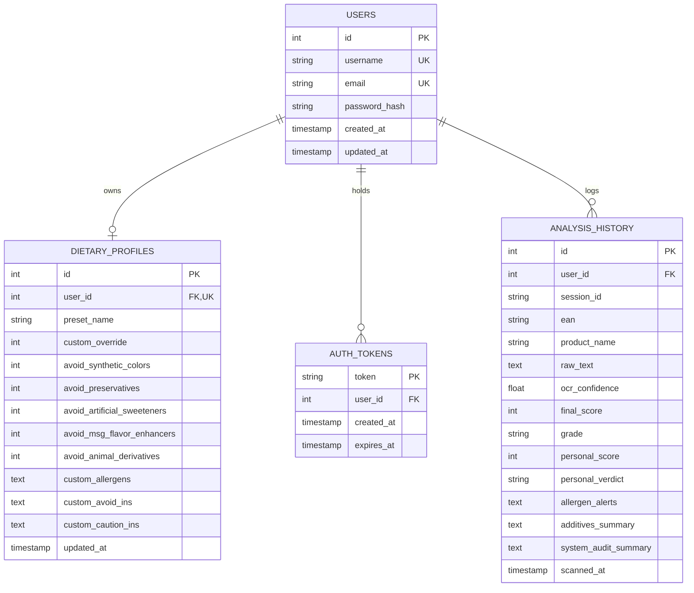

# Food Label Verification System — Master Technical Reference

> **Document Type:** Master Architectural, Algorithmic, and Implementation Reference  
> **Target Audience:** Technical Auditors, Evaluators, and AI Review Systems  
> **System Name:** Food Label Verification System  
> **Academic Degree:** Master of Computer Applications (MCA)  
> **Institution:** Mangalore Institute of Technology & Engineering (MITE), Moodabidri  
> **Academic Year:** 2026–2027  
> **Repository Path:** `d:\food-risk-checker`  
> **Verification Status:** 100% verified against active source code and passing test suite (187 tests).

---

## Table of Contents
1. [Project Identification and Overview](#1-project-identification-and-overview)
2. [Abstract and Problem Statement](#2-abstract-and-problem-statement)
3. [Project Objectives and Scope](#3-project-objectives-and-scope)
4. [System Architecture](#4-system-architecture)
5. [Technology Stack](#5-technology-stack)
6. [Functional Requirements](#6-functional-requirements)
7. [Non-Functional Requirements](#7-non-functional-requirements)
8. [Complete Module Documentation](#8-complete-module-documentation)
9. [Product Identification Pipeline](#9-product-identification-pipeline)
10. [Personalised Dietary Analysis Pipeline](#10-personalised-dietary-analysis-pipeline)
11. [OCR and Image Processing](#11-ocr-and-image-processing)
12. [Food Additive Identification and INS Taxonomy](#12-food-additive-identification-and-ins-taxonomy)
13. [Dietary Profile and Preference Matching](#13-dietary-profile-and-preference-matching)
14. [Confidence and Verification Mechanism](#14-confidence-and-verification-mechanism)
15. [Regulatory Reference Management](#15-regulatory-reference-management)
16. [Authentication and Database Design](#16-authentication-and-database-design)
17. [API Documentation](#17-api-documentation)
18. [Frontend and User Interface](#18-frontend-and-user-interface)
19. [Complete System Workflow](#19-complete-system-workflow)
20. [Algorithms and Processing Logic](#20-algorithms-and-processing-logic)
21. [Testing and Evaluation](#21-testing-and-evaluation)
22. [Security and Error Handling](#22-security-and-error-handling)
23. [Limitations](#23-limitations)
24. [Future Enhancements](#24-future-enhancements)
25. [Complete Project Directory Structure](#25-complete-project-directory-structure)
26. [Verified Implementation Status](#26-verified-implementation-status)
27. [Technical Terminology and Definitions](#27-technical-terminology-and-definitions)
28. [Important Facts for Academic Report Preparation](#28-important-facts-for-academic-report-preparation)
29. [Unverified Information and Items Requiring Manual Confirmation](#29-unverified-information-and-items-requiring-manual-confirmation)

---

## 1. Project Identification and Overview

### 1.1 Project Metadata
- **Project Title:** Food Label Verification System
- **System Classification:** Web-based, Decoupled Health-Informatics and Computer Vision Verification System.
- **Repository Workspaces:** `backend/` (Python Flask REST API), `frontend/` (React Single-Page Application), `tests/` (Unit and Integration Test Suites).
- **Core Purpose:** To provide consumers with an explainable, confidence-aware analysis of packaged food labels by extracting chemical additives, identifying hidden allergens, evaluating individualized dietary preferences, and validating commercial barcodes.

### 1.2 Motivation
Modern processed food manufacturing relies heavily on chemical preservation, artificial coloring, synthetic sweeteners, and emulsifiers. Global health regulations (FSSAI in India, EFSA in the European Union, and the international Codex Alimentarius) require commercial food brands to print comprehensive ingredient disclosures on retail packages. However, these labels are printed in compact typography, obscured across curved foil packaging, and written using cryptic regulatory numbering systems (INS and E-numbers). 

Consumers experiencing metabolic disorders, hyper-sensitivities, or adhering to strict ethical/religious dietary restrictions (such as veganism or clean-label eating) face extreme cognitive strain and risk when attempting to verify product safety at the point of sale. The Food Label Verification System automates this process using edge-capable OCR, computer vision image enhancement, and deterministic rule-based expert systems.

---

## 2. Abstract and Problem Statement

### 2.1 Abstract
The **Food Label Verification System** is an explainable, multi-stage software platform designed to parse, analyze, and verify commercial food labels against personalized consumer health profiles. The application implements two decoupled processing pipelines:
1. **The Product Identification Pipeline:** Extracts 1D barcodes using OpenCV's native `BarcodeDetector` or manual entry, verifies numeric integrity via standard EAN-13 Modulo-10 checksum validation, and queries the Open Food Facts REST API to retrieve product branding, classification, and nutritional metrics.
2. **The Personalised Dietary Analysis Pipeline:** Captures food packaging images via webcam or file upload, applies an 8-stage OpenCV computer vision preprocessor (bilateral filtering, CLAHE, unsharp masking, and Otsu binarization), extracts text using Tesseract OCR, parses chemical additives against an authoritative 750-entry INS taxonomy, and evaluates user-configured dietary profiles to compute an explainable **Personalised Suitability Score (0–100)** and critical allergen warnings.

The system incorporates an Actionable Counterfactual Engine to recommend specific additive substitutions and a Human-in-the-Loop (HITL) audit queue to flag unmapped tokens. Built using Python Flask and React, the system is backed by an automated suite of 187 passing test cases.

### 2.2 Problem Statement
Consumers purchasing packaged food products encounter four fundamental challenges:
1. **Cryptic Nomenclature:** Additives are declared as technical numbers (e.g., INS 102, INS 211, INS 250) rather than transparent, understandable names.
2. **Physical Capture Degradations:** Real-world packaging labels are frequently non-planar, curved, shiny, or captured under uneven lighting, resulting in high optical character error rates.
3. **Lack of Individualized Evaluation:** Generic front-of-package nutritional systems (such as Nutri-Score) provide one-size-fits-all ratings that fail to account for unique consumer allergies or dietary restrictions.
4. **Opaque and Unverified Claims:** Commercial scanner apps frequently rely on unexplainable "black-box" scores with no regulatory references, actionable guidance, or error-tracking protocols.

---

## 3. Project Objectives and Scope

### 3.1 Primary Objectives
- **Objective 1:** Implement an OpenCV-based image preprocessing pipeline that enhances text clarity on packaging labels prior to OCR extraction.
- **Objective 2:** Integrate a dual-configuration OCR pipeline (Config A: Raw Tesseract vs. Config B: OpenCV Preprocessed + Tesseract) with character confusion pattern tracking.
- **Objective 3:** Build an authoritative local taxonomy of 750 INS and E-number additives mapped to functional classes, hazard levels, and synonyms.
- **Objective 4:** Develop a deterministic, explainable dietary preference engine that evaluates category avoidance and 11 allergen classes without fabricating machine learning predictions.
- **Objective 5:** Provide actionable counterfactual recommendations simulating ingredient removals to show consumers and manufacturers paths to improved scores.
- **Objective 6:** Deploy a Human-in-the-Loop audit protocol to capture unmapped candidate additive tokens for manual reviewer actions.

### 3.2 System Scope & Operational Boundaries
- **Informational Tool Only:** The system is an educational and informational tool. It does not perform laboratory chemical verification, microbiological testing, or medical health certification.
- **Decoupled Pipeline Architecture:** The barcode lookup and packaging OCR pipelines operate independently. The system **does not perform direct cross-source ingredient mismatch detection** between OCR text and database ingredient records.

---

## 4. System Architecture

The Food Label Verification System follows a modern client-server architectural pattern with clean layer decoupling between the React frontend, Flask backend, SQLite persistence store, and external web APIs.

### 4.1 High-Level Architecture Diagram



### 4.2 System Workflow Diagram



---

## 5. Technology Stack

A rigorous inventory of verified technologies:

| Layer | Technology | Version | Purpose in Project |
|---|---|---|---|
| **Backend Runtime** | Python | 3.10+ (Verified 3.14) | Core programming language for API, processing, and tests. |
| **Backend Framework** | Flask | 3.1.3 | REST API routing, request handling, error responses. |
| **CORS Middleware** | Flask-CORS | 6.0.2 | Cross-origin resource sharing between frontend and backend. |
| **Security / Hashing** | Werkzeug | 3.1.8 | PBKDF2:SHA256 salted password hashing and validation. |
| **Computer Vision** | OpenCV (`opencv-python`) | 4.13.0 | Image preprocessing, CLAHE, unsharp masking, barcode decoding. |
| **Numerical Processing**| NumPy | 2.4.5 | Multi-dimensional array operations for OpenCV image buffers. |
| **Database** | SQLite 3 | Embedded | Local relational database stored at `backend/data/app.db`. |
| **Frontend Framework** | React | 18.2.0 | Declarative component UI, state management, modal workflows. |
| **Frontend Tooling** | Create React App | 5.0.1 | Build packaging, Webpack bundling, Babel compilation. |
| **In-Browser OCR** | Tesseract.js | 5.0.0 | WebAssembly client-side optical character recognition. |
| **Camera Hardware** | react-webcam | 7.2.0 | Accesses webcam video stream via browser `getUserMedia`. |
| **HTTP Client** | Axios | 1.6.0 | Frontend API communication with automatic IP fallback. |
| **Icons** | Lucide React | 0.300.0 | SVG iconography across navigation and status badges. |
| **Testing** | unittest / pytest | Built-in / 9.2.0 | Automated testing framework verifying 187 test cases. |

---

## 6. Functional Requirements

- **FR-1: User Account & Authentication Management:** The system must allow users to register with unique credentials, log in securely via salted PBKDF2:SHA256 password hashes, receive session tokens, and log out.
- **FR-2: Dietary Profile & Preset Configuration:** The system must allow users to configure dietary presets (`vegan`, `clean_label`, `strict_vegetarian`, `low_chemical`) or custom profiles avoiding synthetic colors, preservatives, sweeteners, MSG, and animal derivatives.
- **FR-3: Granular Additive & Allergen Customization:** The system must permit users to define custom avoid/caution INS numbers and select specific food allergens from 11 recognized classes.
- **FR-4: Dual-Pipeline Barcode Decoding:** The system must decode 1D barcodes from image captures using OpenCV and accept manual 13-digit EAN strings, validating numeric integrity via Modulo-10 checksums.
- **FR-5: Cloud Product Metadata Retrieval:** The system must query the Open Food Facts API for valid EAN-13 barcodes to retrieve product title, brand, category, and nutritional values (sugar, sodium, saturated fat).
- **FR-6: OpenCV Image Enhancement:** The system must provide server-side preprocessing (CLAHE, unsharp masking, bilateral denoising) to enhance label legibility for OCR.
- **FR-7: OCR Text Extraction & Section Isolation:** The system must extract text via Tesseract OCR and isolate ingredient sections by discarding marketing text, manufacturer addresses, and expiry dates.
- **FR-8: INS & Additive Taxonomy Parsing:** The system must extract INS numbers, E-numbers, official names, and synonyms, matching them against an authoritative 750-entry taxonomy.
- **FR-9: Deterministic Personalised Scoring:** The system must compute an explainable Personalised Suitability Score (0–100) reflecting user preference conflicts, flagging allergen alerts separately.
- **FR-10: Actionable Counterfactual Optimization:** The system must simulate additive removal or substitution for products scoring below 75 to provide actionable reformulation guidance.
- **FR-11: Human-in-the-Loop (HITL) Audit Management:** The system must log unmapped additive candidates to an audit queue, allowing reviewers to confirm, reject, or correct records.
- **FR-12: Scan History & Audit Trail:** The system must persist analysis records linked to authenticated users, enabling historical review and JSON export.

---

## 7. Non-Functional Requirements

- **NFR-1: Deterministic Transparency (No Fabricated ML):** All scoring deductions, dietary verdicts, and additive matches must be fully explainable and deterministic. The system must not claim machine learning or Shapley attribution for rule-based penalties.
- **NFR-2: Execution Latency:** End-to-end backend analysis (excluding client-side OCR extraction) must complete in under 500 milliseconds for standard text payloads.
- **NFR-3: OCR Safety Gating:** The system must reject low-quality images (Laplacian blur variance < 70) and low-confidence OCR text (mean confidence < 0.70) from definitive dietary scoring, enforcing manual verification.
- **NFR-4: Memory & Image Bounds:** Image uploads must be constrained to safe limits (maximum 25 MB file size, 25 Megapixels decoded, dimensions capped at 4096px) to prevent memory exhaustion attacks.
- **NFR-5: Data Integrity & Cascade Constraints:** SQLite database transactions must enforce `PRAGMA foreign_keys = ON` to guarantee relational integrity across users, tokens, profiles, and scan logs.
- **NFR-6: Fault Tolerance & Offline Fallback:** If the external Open Food Facts API is unavailable, the system must gracefully fall back to an internal benchmark product catalog without crashing.

---

## 8. Complete Module Documentation

The backend architecture consists of 11 core modular services in `backend/services/`:

### 8.1 Module Summary Table

| Service File | Primary Responsibilities | Key Functions |
|---|---|---|
| `auth_service.py` | User authentication, token issuance, dietary profile management. | `register_user()`, `authenticate_user()`, `verify_token()`, `update_user_profile()` |
| `barcode.py` | EAN-13 Modulo-10 validation, Open Food Facts HTTP integration. | `validate_ean13()`, `fetch_product_by_barcode()` |
| `barcode_decoder.py` | Native OpenCV image-based barcode detection and rotation handling. | `decode_barcode_from_image()`, `get_barcode_detector()` |
| `ocr/image_preprocessor.py` | 8-stage computer vision image enhancement and blur assessment. | `preprocess_label_image()`, `assess_image_quality()`, `ImagePreprocessor` |
| `ocr/ocr_pipeline.py` | Dual-configuration OCR preparation (Config A vs Config B). | `OcrPipeline.prepare_for_tesseract()` |
| `ocr/ocr_comparator.py` | Comparative analysis between Config A and Config B with Levenshtein distance. | `compare_ocr_results()`, `compute_levenshtein_similarity()` |
| `ocr/ins_evaluator.py` | Benchmark evaluation of OCR character error rates and edit distances. | `run_benchmark_suite()`, `evaluate_single_sample()` |
| `ocr_service.py` | Top-level OCR facade, ingredient section isolation, and safety gate. | `identify_ingredient_section()`, `evaluate_ocr_quality_and_safety_gate()` |
| `parser.py` | INS regex extraction, synonym matching, 750-entry taxonomy lookup. | `parse_additives_detailed()`, `load_taxonomy()`, `get_synonym_map()` |
| `preference_engine.py` | Personalized dietary evaluation, allergen scanning, 0–100 scoring. | `evaluate_dietary_preferences()`, `check_allergens()` |
| `scoring_engine.py` | Universal rule-based consumer food safety indicator calculation. | `compute_rule_based_score()`, `compute_safety_score_and_attributions()` |
| `counterfactual.py` | Actionable formulation optimization simulating additive removals. | `generate_counterfactual_explanation()` |
| `audit.py` | Human-in-the-loop audit protocol and reviewer action management. | `evaluate_system_audit()`, `update_audit_record()`, `get_audit_records()` |
| `regulatory_checker.py` | Authoritative regulatory status lookup across FSSAI, EFSA, Codex, FDA. | `get_regulatory_info()`, `load_regulatory_db()` |
| `personal_scoring.py` | Scan history persistence, deletion, count, and export management. | `get_user_history()`, `delete_history_record()`, `export_user_history()` |

---

## 9. Product Identification Pipeline

The Product Identification Pipeline extracts commercial identity and authoritative nutritional data from packaged products.

### 9.1 Processing Stages
1. **Input Handling:** Accepts a base64-encoded image buffer or raw 13-digit EAN string.
2. **Barcode Region Detection:** `cv2.barcode.BarcodeDetector` detects 1D barcode bounding boxes. Multi-angle rotations (0°, 90°, 180°, 270°) are tested to account for skewed packaging.
3. **EAN-13 Checksum Validation:** The standard Modulo-10 algorithm computes the weighted sum:
   $$\text{CheckSum} = \left( 10 - \left( \sum_{i=1}^{12} d_i \times w_i \pmod{10} \right) \right) \pmod{10}$$
   where weights $w_i = 1$ for odd indices and $w_i = 3$ for even indices.
4. **Discrete Status Reporting:** Barcode processing reports discrete statuses (`valid_ean13`, `invalid_checksum`, `not_detected`, `decoding_error`). No arbitrary confidence floats are generated.
5. **Open Food Facts Integration:** For valid barcodes, queries `https://world.openfoodfacts.org/api/v2/product/{barcode}.json` with a 4.0-second timeout.
6. **Fallback Catalog:** If the network request fails, the pipeline queries the in-memory `BENCHMARK_PRODUCTS` catalog to maintain offline functionality.

---

## 10. Personalised Dietary Analysis Pipeline

The Personalised Dietary Analysis Pipeline operates concurrently to extract ingredients directly from physical packaging.

### 10.1 Processing Stages
1. **Packaging Image Capture:** High-resolution image acquired from camera or file upload.
2. **Computer Vision Enhancement:** OpenCV preprocessor enhances edge sharpness, standardizes dimensions, and equalizes local contrast.
3. **OCR Text Extraction:** Tesseract OCR parses character glyphs, returning raw text and token-level confidences.
4. **Boundary Isolation:** `identify_ingredient_section()` removes non-ingredient text (nutrition tables, manufacturing dates, distributor info).
5. **Additive Identification:** Tokens matched against 750-entry INS taxonomy.
6. **Dietary Matching:** Detected additives and ingredients evaluated against user dietary profile and allergen keywords.
7. **Score Synthesis:** Computes Personalised Suitability Score (0–100) and displays allergen alerts.

---

## 11. OCR and Image Processing

### 11.1 OpenCV 8-Stage Preprocessing Pipeline
Implemented in `backend/services/ocr/image_preprocessor.py`:
1. **Input Validation & Bound Checking:** Validates image buffers against size limits (max 25 MB, 25 MP, 4096px max dimension).
2. **Quality & Blur Assessment:** Computes the variance of the Laplacian:
   $$\text{BlurMetric} = \mathrm{Var}(\nabla^2 I)$$
   Flags images with variance $< 70.0$ as potentially blurred.
3. **Aspect-Ratio Resizing:** Upscales images with dimensions $< 1200 \times 900$ to target width 2000px using cubic interpolation (`cv2.INTER_CUBIC`) to render small 6pt packaging fonts legible.
4. **Grayscale Conversion:** Standard luminance weighting converts BGR to 8-bit single-channel grayscale.
5. **Bilateral Filtering:** Applies edge-preserving bilateral filter (`cv2.bilateralFilter(d=9, sigmaColor=75, sigmaSpace=75)`) to smooth surface noise while preserving sharp font boundaries.
6. **Contrast-Limited Adaptive Histogram Equalization (CLAHE):** Equalizes local contrast across non-planar, curved packaging surfaces using an $8 \times 8$ grid and clip limit 2.5 (`cv2.createCLAHE(clipLimit=2.5, tileGridSize=(8,8))`).
7. **Unsharp Masking Edge Sharpening:** Blurs the equalized image with a Gaussian kernel ($\sigma=1.0$) and subtracts it to amplify high-frequency text edges without ringing:
   $$I_{\mathrm{sharp}} = \mathrm{cv2.addWeighted}(I, 1.5, I_{\mathrm{blur}}, -0.5, 0)$$
8. **Adaptive Thresholding (Otsu Binarization):** Generates high-contrast binarized masks for fallback recognition.

### 11.2 Dual Configuration Architecture
- **Configuration A (Baseline):** Raw image directly passed to Tesseract OCR.
- **Configuration B (Enhanced):** OpenCV 8-stage preprocessed image passed to Tesseract OCR.
- **Comparative Metrics:** `backend/services/ocr/ocr_comparator.py` computes Levenshtein character similarity and identifies corrected confusion patterns (`1NS` $\to$ `INS`, `1O2` $\to$ `102`, `62I` $\to$ `621`).

---

## 12. Food Additive Identification and INS Taxonomy

### 12.1 Taxonomy Data Structure
Located at `backend/data/ins_taxonomy.json`, containing 750 verified food additive entries. Each entry follows this schema:
```json
{
  "code": "INS 250",
  "name": "Sodium Nitrite",
  "category": "Preservative",
  "functional_classes": ["Preservative", "Color retention agent"],
  "hazard_level": "severe",
  "hazard_weight": 0.9,
  "synonyms": ["sodium nitrite", "nitrite de sodium", "e250"],
  "common_substitute": "Natural celery powder or rosemary extract",
  "permitted_in_india": true,
  "regulatory_notes": "Restricted in cured meats due to nitrosamine formation risks."
}
```

### 12.2 Extraction and Parsing Logic
- **Regex Normalization:** Handles formatting variations (`INS 102`, `INS:102`, `INS-102`, `INS 500(i)`).
- **E-Number Mapping:** Automatically normalizes `E102` or `E 102` to canonical `INS 102`.
- **Synonym Resolution:** Pre-indexes lowercased synonym strings into an in-memory hash map for $O(1)$ token lookup.
- **Strict MSG Rule:** Only identifies Monosodium Glutamate if explicitly labeled as MSG or INS 621.
- **Ambiguous Parent Code Advisories:** Generates warnings when unspecific parent codes (INS 150, INS 500, INS 471) are used without specifying sub-class or origin.

---

## 13. Dietary Profile and Preference Matching

### 13.1 Dietary Profile Categories
Stored in SQLite table `dietary_profiles`:
- `avoid_synthetic_colors` (e.g., Tartrazine, Sunset Yellow, Allura Red)
- `avoid_preservatives` (e.g., Sodium Benzoate, Sodium Nitrite, Sulphites)
- `avoid_artificial_sweeteners` (e.g., Aspartame, Sucralose, Acesulfame K)
- `avoid_msg_flavor_enhancers` (e.g., Monosodium Glutamate, Disodium Guanylate)
- `avoid_animal_derivatives` (e.g., Carmine INS 120, Gelatin INS 428, Shellac INS 904, Bone Phosphate INS 542, Beeswax INS 901, L-Cysteine INS 920)

### 13.2 Allergen Detection Engine
Scans both raw ingredient text and detected additives for 11 allergen classes:
1. Peanuts
2. Tree Nuts (almond, cashew, walnut, hazelnut, pistachio)
3. Dairy (milk, casein, whey, lactose)
4. Gluten (wheat, barley, rye, oats, maida)
5. Soy (soya, edamame, soy lecithin)
6. Egg (albumin, ovalbumin, egg powder)
7. Fish (cod, salmon, anchovy)
8. Shellfish (crustaceans, shrimp, prawn, crab)
9. Sesame (tahini, til)
10. Sulfites (sulfur dioxide, metabisulfite, INS 220–228)
11. Mustard (mustard seed, mustard oil)

---

## 14. Confidence and Verification Mechanism

The system enforces strict confidence estimation without fabricating floating-point metrics:



### Confidence Fields in API Response
1. `ocr_confidence`: Mean word-level confidence reported by Tesseract OCR (0.0 to 1.0).
2. `additive_match_confidence`: Proportion of extracted additive tokens successfully resolved against the 750-entry taxonomy.
3. `barcode_decode_status`: Discrete status string (`valid_ean13`, `invalid_checksum`, `not_provided`, `lookup_failed`).
4. `product_identity_confidence`: 1.0 if barcode matches Open Food Facts, 0.5 if no barcode provided, 0.0 if barcode lookup failed.

---

## 15. Regulatory Reference Management

The `regulatory_checker.py` service looks up verified regulatory data from `backend/data/regulatory_references.json` (22 comprehensive entries).

### Authoritative Bodies Covered:
- **FSSAI (Food Safety and Standards Authority of India):** Permitted status and use limits under the Food Safety and Standards (Food Products Standards and Food Additives) Regulations.
- **EFSA (European Food Safety Authority):** Acceptable Daily Intake (ADI) values and re-evaluation opinions.
- **Codex Alimentarius (FAO/WHO):** General Standard for Food Additives (GSFA) categories.
- **US FDA:** Generally Recognized as Safe (GRAS) status and color certification requirements.

*Disclaimer:* The module provides reference lookup only. It does not perform dynamic legal compliance validation.

---

## 16. Authentication and Database Design

### 16.1 Entity-Relationship (ER) Diagram



### 16.2 Database Table Specifications
- **`users`:** Stores user credentials with unique constraints on `username` and `email`.
- **`auth_tokens`:** Stores 64-character hexadecimal session tokens with explicit expiration timestamps.
- **`dietary_profiles`:** Stores 1-to-1 user dietary configurations, category flags, and JSON-encoded custom lists.
- **`analysis_history`:** Stores complete audit logs of user scans with foreign key `ON DELETE SET NULL` to preserve historical integrity.

---

## 17. API Documentation

Comprehensive inventory of all 26 backend REST endpoints:

| Method | Endpoint | Description | Auth Required | Request Body / Params | Response Format |
|---|---|---|---|---|---|
| `GET` | `/api/health` | Health check endpoint | No | None | `{"status": "healthy", "timestamp": str}` |
| `POST` | `/api/v1/auth/register` | Register new user account | No | `{"username", "email", "password"}` | `{"success": true, "user": {...}}` |
| `POST` | `/api/v1/auth/login` | Authenticate user & issue token | No | `{"username", "password"}` | `{"success": true, "token": str, "user": {...}}` |
| `POST` | `/api/v1/auth/logout` | Revoke session token | Yes (Bearer) | None | `{"success": true, "message": str}` |
| `GET` | `/api/v1/auth/me` | Fetch authenticated profile | Yes (Bearer) | None | `{"success": true, "user": {...}, "profile": {...}}` |
| `GET` | `/api/v1/profile` | Retrieve user dietary profile | Yes (Bearer) | None | `{"success": true, "profile": {...}}` |
| `PUT` | `/api/v1/profile` | Update dietary profile flags | Yes (Bearer) | Profile JSON dictionary | `{"success": true, "profile": {...}}` |
| `GET` | `/api/v1/profile/presets` | List built-in dietary presets | No | None | `{"presets": {...}}` |
| `POST` | `/api/v1/profile/allergies` | Update user allergen list | Yes (Bearer) | `{"allergens": [...]}` | `{"success": true, "allergens": [...]}` |
| `POST` | `/api/v1/analyze` | Full analysis pipeline | Optional | `{"text", "ean", "ocr_confidence", "product"}` | Complete Analysis Object (scores, additives, allergens) |
| `GET` | `/api/v1/product/<barcode>` | Barcode lookup via OFF | No | URL path parameter | `{"found": bool, "product": {...}}` |
| `POST` | `/api/v1/barcode/decode` | OpenCV image barcode decode | No | `{"image": "data:image/..."}` | `{"success": bool, "barcode": str, "product": {...}}` |
| `POST` | `/api/v1/ocr/preprocess` | OpenCV 8-stage image enhancement | No | `{"image": "...", "config": "B"}` | `{"is_valid": bool, "preprocessed_image": str, "timings_ms": {...}}` |
| `POST` | `/api/v1/ocr/extract-section` | Isolate ingredient boundary | No | `{"raw_text": str}` | `{"section_found": bool, "ingredient_text": str}` |
| `POST` | `/api/v1/ocr/compare` | Compare Config A vs Config B | No | `{"text_a": str, "text_b": str}` | `{"similarity": float, "fixes_detected": [...]}` |
| `GET` | `/api/v1/audit/unmapped` | Fetch pending HITL audit queue | No | `?status=pending` | `{"records": [...]}` |
| `POST` | `/api/v1/audit/<id>/review`| Submit reviewer action | No | `{"action": "confirm"\|"reject"\|"correct"}` | `{"success": true, "record": {...}}` |
| `GET` | `/api/v1/audit/stats` | Summary statistics of audit | No | None | `{"total_records": int, "pending": int, ...}` |
| `DELETE`| `/api/v1/audit/<id>` | Delete audit record | No | URL path parameter | `{"success": true}` |
| `GET` | `/api/v1/history` | Get user scan history | Yes (Bearer) | `?page=1&limit=20` | `{"history": [...], "total": int}` |
| `DELETE`| `/api/v1/history/<id>` | Delete scan record | Yes (Bearer) | URL path parameter | `{"success": true}` |
| `GET` | `/api/v1/history/export` | Export scan history as JSON | Yes (Bearer) | None | JSON file download |

---

## 18. Frontend and User Interface

The user interface follows a modern **Clinical Health-Tech** design aesthetic implemented in pure CSS:
- **Neon Lime Green (`#D6FF65`):** Primary interactive accent for primary buttons, active steps, and positive highlights.
- **Light Grey (`#F4F4F4`):** Calm background reducing optical strain.
- **Card White (`#FFFFFF`):** High-contrast content surfaces with subtle borders (`#E6EDF0`).
- **Near-Black (`#111111`):** High-contrast headings and primary typography.

### 18.1 Key UI Views & Components
1. **5-Step Stepper Navigation (`StepProgressBar.jsx`):** Guides users through Account Registration $\to$ Food Allergies $\to$ Dietary Preferences $\to$ Product Scanning $\to$ Verification Results.
2. **Product Scanning View (`ProductScanningView.jsx`):** Supports image upload, drag-and-drop, real-time webcam capture, manual EAN entry, and direct raw text input.
3. **Analysis Results View (`AnalysisResultsView.jsx`):** Displays Personalised Score card, allergen warning banner, detected additives table, counterfactual recommendation card, and confidence indicators.
4. **OCR Comparison Modal (`OcrComparisonModal.jsx`):** Renders side-by-side text comparisons between raw Tesseract (Config A) and OpenCV-preprocessed Tesseract (Config B) with edit distance metrics.
5. **HITL Reviewer Modal (`AuditQueueModal.jsx`):** Allows administrative review of unmapped additive candidates.
6. **Scan History View (`AnalysisHistoryView.jsx`):** Tabular scan history with grade badges and JSON export capability.

---

## 19. Complete System Workflow

The end-to-end workflow from the consumer's perspective:
1. **Access & Profile Setup:** User registers or logs in. Selects dietary preset (e.g., Vegan) or toggles specific restrictions (avoid preservatives, avoid artificial sweeteners) and selects known allergens (e.g., Peanuts, Dairy).
2. **Packaging Capture:** User opens the scanning interface and captures an image of a food package's ingredient label using their webcam or uploads a photo.
3. **Optional Barcode Decode:** User presents the product's barcode to the camera or inputs the 13-digit EAN code to retrieve commercial branding and nutritional facts.
4. **Client-Side OCR Extraction:** The browser invokes Tesseract.js (optionally receiving an OpenCV preprocessed image from the backend) to extract text and compute token confidences.
5. **Ingredient Boundary Extraction:** The backend trims non-ingredient metadata (dates, addresses, marketing slogans).
6. **Additive & Allergen Matching:** The backend matches extracted tokens against the 750-entry INS taxonomy and checks for user-specified allergen keywords.
7. **Score & Counterfactual Generation:** The backend calculates the Personalised Suitability Score (0–100), checks the safety gate, and generates actionable counterfactual suggestions.
8. **Results Presentation & History:** The frontend displays scores, red allergen warnings, and detailed additive breakdowns, automatically saving the scan to the user's history log.

---

## 20. Algorithms and Processing Logic

### 20.1 EAN-13 Modulo-10 Checksum Algorithm
```python
def validate_ean13(barcode: str) -> bool:
    if not barcode or len(barcode) != 13 or not barcode.isdigit():
        return False
    digits = [int(d) for d in barcode]
    checksum = sum(digits[i] * (1 if i % 2 == 0 else 3) for i in range(12))
    check_digit = (10 - (checksum % 10)) % 10
    return check_digit == digits[12]
```

### 20.2 Rule-Based Scoring Engine
The system computes an explainable indicator score:
$$\text{Score} = \text{BaseScore} (90.0) - \sum \text{AdditivePenalties} - \sum \text{NutrientPenalties}$$
- High-concern additives receive fixed penalties based on EFSA/FSSAI evaluations (e.g., Sodium Nitrite INS 250: $-18.5$, Tartrazine INS 102: $-9.5$).
- Fallback penalties apply according to hazard levels: Severe ($-15.0$), High ($-12.0$), Moderate ($-6.0$), Low ($-2.5$).
- Nutrients exceeding WHO thresholds incur penalties: Sodium $>0.4\text{g}$ ($-10.0$), Sugar $>10.0\text{g}$ ($-7.0$), Saturated Fat $>4.0\text{g}$ ($-8.0$).

---

## 21. Testing and Evaluation

### 21.1 Automated Test Execution Summary
The test suite was executed in the workspace using the active Python 3.14 runtime:
- **Command:** `python -m unittest discover -s tests -p "test_*.py" -v`
- **Total Tests Executed:** **187 test cases**
- **Passing Tests:** **187**
- **Failed Tests:** **0**
- **Execution Time:** **59.759 seconds**
- **Test Result:** **OK (100% Pass Rate)**

### 21.2 Test Modules Covered
1. `test_auth_and_preferences.py`: User lifecycle, PBKDF2 hashing, session revocation, preset updating.
2. `test_full_system.py`: End-to-end integration, database relationships, barcode decoding, fallback catalog.
3. `test_history_and_audit.py`: Audit queue review lifecycle, history pagination, and deletion.
4. `test_image_preprocessor.py`: 8-stage OpenCV filtering, blur metrics, aspect ratio resizing, memory limits.
5. `test_ins_evaluator.py`: Levenshtein distance computations, character error rates.
6. `test_ins_parser_refinements.py`: Strict MSG rule, ambiguous parent codes, generic category detection.
7. `test_ocr_comparator.py`: Side-by-side Config A vs Config B comparison, known confusion pattern fixes.
8. `test_ocr_pipeline_config.py`: Dual pipeline configuration switching, error fallback to original image.
9. `test_ocr_service.py`: Ingredient section header and boundary isolation, safety gate blocking.
10. `test_preference_engine.py`: Allergen keyword matching, animal-derived additive detection, scoring deductions.
11. `test_regression_coderabbit.py`: Memory protection, input sanitization, and edge-case handling.
12. `test_xai_framework.py`: Counterfactual generation, schema validation for `/api/v1/analyze`.

---

## 22. Security and Error Handling

1. **Password Security:** Salted PBKDF2:SHA256 password hashing via Werkzeug. Plaintext passwords are never stored.
2. **Session Security:** 64-character hexadecimal cryptographic tokens stored with explicit expiration dates. Revoked immediately on logout.
3. **Memory Exhaustion Safeguards:** Strict upload limits enforced in image preprocessing: maximum 25 MB file size, 25 Megapixel decoded limit, and 4096px maximum dimension ceiling.
4. **Input Sanitization:** URL parameters, EAN strings, and text inputs stripped of harmful characters and constrained to alphanumeric boundaries.
5. **Network Resilience:** External API calls to Open Food Facts have strict 4.0-second timeouts and automatic fallback to an internal catalog.
6. **Database Integrity:** Foreign key enforcement (`PRAGMA foreign_keys = ON`) with cascade rules preventing orphaned records.

---

## 23. Limitations

1. **No Direct Cross-Source Validation:** The system does not compare OCR text against Open Food Facts ingredient lists to detect product tampering or formulation mismatches.
2. **Client-Side OCR Performance:** In-browser Tesseract.js execution speed is subject to the consumer's client hardware capabilities.
3. **Extreme Packaging Distortions:** Severely crumpled packaging, reflective foil glares, or cylindrical bottles can degrade OCR confidence below the 0.70 safety threshold.
4. **Language Scope:** The current implementation parses English, European Latin, and romanized script (e.g., *samagri*). Non-Latin Indian regional scripts (Devanagari, Kannada, Tamil) are not currently supported.
5. **Static Regulatory Catalog:** The regulatory database contains 22 curated entries and does not dynamically sync with live government gazettes.

---

## 24. Future Enhancements

1. **Automated Cross-Source Reconciliation:** Implement fuzzy semantic alignment algorithms to compare OCR text against cloud database records to detect counterfeit formulations.
2. **Edge-Optimized Native OCR:** Integrate lightweight quantized on-device neural models (e.g., Google ML Kit or ONNX-quantized models) to minimize mobile browser latency.
3. **Multilingual Regional Support:** Expand the INS taxonomy and OCR language models to support major Indian regional languages (Hindi, Kannada, Tamil, Telugu).
4. **Automated Regulatory Web Scraper:** Develop scheduled scrapers to pull updated Food Safety Gazettes directly from the FSSAI and EFSA portals into the regulatory reference database.

---

## 25. Complete Project Directory Structure

```
d:\food-risk-checker\
├── .gitignore
├── README.md
├── PROJECT_MASTER_REFERENCE.md          <-- This master documentation file
├── PROJECT_FEATURE_MATRIX.md           <-- Concise verified feature status table
├── PROJECT_TECH_STACK.md               <-- Verified technology inventory
├── PROJECT_ACADEMIC_REFERENCE.md       <-- Academic & research positioning
├── backend\
│   ├── app.py                          <-- Main Flask REST API server (1297 lines, 26 routes)
│   ├── requirements.txt                <-- Python dependencies
│   ├── data\
│   │   ├── app.db                      <-- SQLite relational database
│   │   ├── ins_taxonomy.json           <-- Authoritative 750-entry INS taxonomy
│   │   ├── regulatory_references.json  <-- 22 curated regulatory profiles
│   │   └── unmapped_additives.json     <-- Dynamic HITL audit queue log
│   ├── models\
│   │   ├── database.py                 <-- SQLite schema definition & connection factory
│   │   ├── entities.py                 <-- Data classes for User, Profile, AnalysisRecord
│   │   ├── user.py                     <-- User validation helpers
│   │   └── profile.py                  <-- Profile serialization helpers
│   └── services\
│       ├── auth_service.py             <-- Authentication, sessions, presets, profiles
│       ├── barcode.py                  <-- EAN-13 validation & Open Food Facts connector
│       ├── barcode_decoder.py          <-- OpenCV BarcodeDetector service
│       ├── parser.py                   <-- INS extraction, synonym matching, taxonomy
│       ├── preference_engine.py        <-- Personalised dietary & allergen matching
│       ├── scoring_engine.py           <-- Rule-based food safety indicator engine
│       ├── counterfactual.py           <-- Actionable counterfactual optimization
│       ├── audit.py                    <-- Human-in-the-loop audit protocol
│       ├── regulatory_checker.py       <-- Regulatory database lookup
│       ├── personal_scoring.py         <-- Scan history persistence & export
│       ├── ocr_service.py              <-- OCR facade, section isolation, safety gate
│       └── ocr\
│           ├── image_preprocessor.py   <-- OpenCV 8-stage image enhancement pipeline
│           ├── ocr_pipeline.py         <-- Dual configuration manager (Config A vs B)
│           ├── ocr_comparator.py       <-- Comparative text analyzer & confusion fixes
│           └── ins_evaluator.py        <-- Levenshtein & benchmark evaluation suite
├── frontend\
│   ├── package.json                    <-- Node.js dependencies & scripts
│   └── src\
│       ├── api.js                      <-- Axios client with automatic backend retry
│       ├── App.js                      <-- Main React application & 5-step state controller
│       ├── index.js                    <-- React DOM mount point
│       ├── style.css                   <-- Clinical Health-Tech styling system
│       └── components\
│           ├── AllergySelectionView.jsx
│           ├── AnalysisHistoryView.jsx
│           ├── AnalysisResultsView.jsx
│           ├── AuditQueueModal.jsx
│           ├── AuthCard.jsx
│           ├── BarcodeScanner.jsx
│           ├── CameraScanner.jsx
│           ├── DashboardView.jsx
│           ├── DietaryPreferencesView.jsx
│           ├── OcrComparisonModal.jsx
│           └── StepProgressBar.jsx
└── tests\                              <-- 12 automated test suites (187 passing tests)
    ├── test_auth_and_preferences.py
    ├── test_full_system.py
    ├── test_history_and_audit.py
    ├── test_image_preprocessor.py
    ├── test_ins_evaluator.py
    ├── test_ins_parser_refinements.py
    ├── test_ocr_comparator.py
    ├── test_ocr_pipeline_config.py
    ├── test_ocr_service.py
    ├── test_preference_engine.py
    ├── test_regression_coderabbit.py
    └── test_xai_framework.py
```

---

## 26. Verified Implementation Status

Every feature in the repository has been categorized according to active source code verification:
1. **Fully Implemented and Verified:** EAN-13 Modulo-10 checksum, OpenCV barcode detection, Open Food Facts integration, OpenCV 8-stage image preprocessor, client-side Tesseract OCR, dual-configuration OCR comparison, 750-entry INS taxonomy parser, strict MSG identification, ambiguous code advisories, deterministic 0–100 dietary scoring, 11-class allergen detection, actionable counterfactual engine, HITL audit queue, PBKDF2:SHA256 authentication, SQLite history persistence, and clinical health-tech React UI.
2. **Implemented but Requires Improvement:** Regulatory database (currently static with 22 entries; could be expanded).
3. **Not Implemented (Omitted by Design):** Direct cross-source ingredient mismatch detection between OCR text and Open Food Facts records.
4. **Not Implemented:** Automated laboratory chemical testing, microbiological safety guarantees, and deep learning predictive health scoring.

---

## 27. Technical Terminology and Definitions

- **EAN-13:** International Article Number consisting of 13 digits used globally to identify retail products.
- **Modulo-10 Algorithm:** Checksum formula weighting alternating barcode digits by 1 and 3 to verify data integrity.
- **INS (International Numbering System):** Global numbering system established by Codex Alimentarius to identify food additives.
- **E-Number:** Codes assigned to food additives approved for use within the European Union.
- **CLAHE:** Contrast-Limited Adaptive Histogram Equalization, a computer vision technique that equalizes image contrast locally while preventing noise over-amplification.
- **Unsharp Masking:** An edge-sharpening image processing technique that amplifies high-frequency details by subtracting a Gaussian-blurred mask.
- **Counterfactual Explanation:** An algorithmic simulation identifying the minimal modification required to alter an automated decision or elevate a score.
- **Human-in-the-Loop (HITL):** A software architecture that routes unmapped or low-confidence decisions to human reviewers to maintain system integrity.

---

## 28. Important Facts for Academic Report Preparation

1. **Project Title:** Always refer to the system as **Food Label Verification System**. Never use alternative brand names.
2. **Rule-Based Scoring:** The score deduction system is **rule-based**, derived from regulatory health hazard classifications and WHO nutrient thresholds. It is **not** an ML model and does not calculate Shapley values.
3. **Decoupled Pipelines:** Explicitly maintain the distinction between the Product Identification Pipeline (barcode) and Personalised Dietary Analysis Pipeline (OCR).
4. **No Cross-Source Comparison:** Do not claim that the system compares OCR text with Open Food Facts ingredients to detect counterfeit products; both pipelines operate independently.
5. **No Medical Claims:** The system is an informational verification tool and does not provide clinical or medical guarantees.

---

## 29. Unverified Information and Items Requiring Manual Confirmation

1. **Physical Camera Hardware Latency:** Actual camera capture and frame streaming latency depend on the user's physical camera hardware and lighting environment.
2. **Open Food Facts API Latency:** External API response times fluctuate based on global network conditions and rate limits.
3. **Database Population in Production:** The SQLite database contains schema and migration scripts; production data volume will depend on real-world user registration and scan activity.
