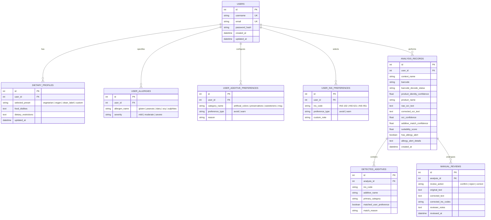

# Food Label Verification System — Project Audit & Implementation Plan

**Project Title:** A Confidence-Aware Multimodal Food Label Verification System Using Deep Learning and OCR  
**System Name:** Food Label Verification System  
**Stage:** Phase 1 — Comprehensive Baseline Audit & Architectural Roadmap  
**Date:** 2026-11-02  
**Status:** Audit Completed · Ready for Phased Execution

---

## 1. Executive Summary

This report delivers a thorough architectural, algorithmic, and data-level audit of the existing **Food Label Verification System** codebase at `d:\food-risk-checker`. 

The primary research and engineering objective is to transform the existing single-scan risk checker into an authenticated, confidence-aware, personalised food label verification platform. The application bifurcates into two distinct, decoupled analytical pipelines:
1. **Product Identification Pipeline:** Food package image / barcode capture → Barcode detection & decoding → EAN-13 checksum validation → Open Food Facts database retrieval (independent product identity evidence).
2. **Personalised Dietary Analysis Pipeline:** Packaging image capture → OCR text extraction & cleaning → Ingredient section identification → INS number & additive taxonomy classification → User dietary profile & preset preference matching → Personalised food suitability scoring (0–100).

> [!IMPORTANT]
> Per system specifications, automatic ingredient-level cross-source comparison between OCR-extracted ingredients and barcode-linked product reference ingredients is **strictly omitted**. Unreliable OCR outputs on curved or reflective packaging generate false mismatches; thus, barcode product information is provided strictly for independent product identification and reference.

---

## 2. Current Architecture & Codebase Map

### 2.1 Backend Architecture (Flask 3.1.3 on Python 3.14)
- **Directory:** `backend/`
- **Port:** `5005` (bound to `0.0.0.0` with CORS enabled)
- **Service Modules:**
  - `backend/app.py`: Main Flask API server handling request validation, routing, and response assembly.
  - `backend/services/barcode.py`: Modulo-10 EAN-13 checksum validator, benchmark product catalog (4 items), and Open Food Facts HTTP connector.
  - `backend/services/parser.py`: OCR typo normalizer (`I->1`, `O->0`), INS/E-number regex extractor with Codex range validation (100–1599) and nutrition-unit false-positive filters, and 65-entry chemical name dictionary.
  - `backend/services/scoring_engine.py`: Baseline rule-based safety indicator score (base 90.0 − weighted additive/nutrient deductions).
  - `backend/services/counterfactual.py`: Single-additive removal simulation when score < 75.
  - `backend/services/audit.py`: Human-in-the-loop (HITL) audit logger with deduplication, four-way confidence reporting, and reviewer update persistence.
  - `backend/services/regulatory_checker.py`: Lookup service querying regulatory status across FSSAI, EFSA, Codex, FDA, and IARC.
- **Data Stores:**
  - `backend/data/ins_taxonomy.json`: Flat JSON mapping 750 keys to 250 unique additives with hazard levels and functional classes.
  - `backend/data/regulatory_references.json`: Schema v2.1 containing 22 enriched additive entries with primary citations and DOI URLs.
  - `backend/data/unmapped_additives.json`: Audit log of unrecognised tokens pending human review.

### 2.2 Frontend Architecture (React 18 / CRA)
- **Directory:** `frontend/`
- **Port:** `3001`
- **Main Shell:** `src/App.js` with 3 input tabs (Barcode, Live Camera, Image Upload).
- **Component Hierarchy:**
  - `BarcodeScanner.jsx`: Client-side EAN-13 modulo-10 validator with 4 benchmark chips.
  - `CameraScanner.jsx`: `react-webcam` with guide box overlay, autofocus delay, and center-crop processing.
  - `ImageUpload.jsx`: Drag-and-drop file upload triggering Tesseract OCR.
  - `ConfidencePanel.jsx`: Displays 4 confidence dimensions (OCR, Additive Matching, Barcode Status, Product Identity).
  - `SafetyScoreCard.jsx`: SVG circular gauge (0–100) displaying baseline score and deductions.
  - `ShapAttributionChart.jsx`: Horizontal deduction impact bar chart with filter pills.
  - `CounterfactualCard.jsx`: Reformulation simulation card.
  - `AuditQueueModal.jsx`: HITL review queue allowing confirm, reject, and correct actions.
  - `AuditStatusBadge.jsx`: Legacy component retained for backward compatibility.
  - `api.js`: Axios client with auto-retry fallback between `localhost:5005` and `127.0.0.1:5005`.
  - `style.css`: Glassmorphism design system with responsive breakpoints at 992px, 900px, and 600px.

---

## 3. Existing API Endpoints & Contracts

| Endpoint | Method | Request Payload / Params | Response Structure | Purpose |
|---|---|---|---|---|
| `/` | `GET` | None | `{ status, service, version, endpoints }` | Service discovery |
| `/api/health` | `GET` | None | `{ status: "healthy", service: "safebite-2.0", scoring_method }` | Health probe |
| `/api/v1/analyze` | `POST` | `{ ean?, text?, ocr_confidence?, nutrients?, product? }` | `{ product, parsed_additives, unmapped_tokens, safety_indicator, safety_scoring, counterfactual_explanation, system_audit }` | Main analysis pipeline |
| `/api/v1/product/<barcode>` | `GET` | URL param `barcode` | `{ valid_ean13: bool, product: dict }` | Barcode validation + OFF lookup |
| `/api/v1/audit/unmapped` | `GET` | Query param `?status=...` (optional) | `{ total_records: int, records: list }` | HITL audit queue retrieval |
| `/api/v1/audit/<id>/review` | `POST` | `{ action: "confirm"\|"reject"\|"correct", corrected_tokens?, reviewer_note? }` | `{ success: bool, message: str }` | Reviewer action submission |
| `/analyze` | `POST` | `{ text: str }` | `{ detected_additives, overall_risk_score, overall_risk_level, xai_scoring }` | Legacy backward-compatible endpoint |

---

## 4. Feature Gap Analysis

### 4.1 Implemented & Working Features
- ✅ **Deterministic EAN-13 Validation:** Modulo-10 checksum algorithm works reliably in both Python backend and JavaScript frontend.
- ✅ **Open Food Facts API Connector:** Retrieves live product metadata with fallback to local benchmark catalog and automatic salt-to-sodium conversion.
- ✅ **OCR Text Preprocessing:** Dynamic contrast/brightness adjustments and dual-pass typo correction (`INS lOl` → `INS 101`, `INS 25O` → `INS 250`).
- ✅ **Codex E-Number Filtering:** Rejects dates (`E2026`), short codes (`E10`), and suppresses false positives from nutrition contexts (`Vitamin E 100mg`, `E100mg`).
- ✅ **Traceable Regulatory Database:** 22 priority additives mapped with governing authority, source DOIs, and applicable use conditions.
- ✅ **HITL Audit Queue:** Deduplicated logging to `unmapped_additives.json` with disk-persisted reviewer actions (`confirm`, `reject`, `correct`).
- ✅ **Four Separate Confidence Dimensions:** Backend exposes `ocr_confidence`, `additive_match_confidence`, `barcode_decode_status`, and `product_identity_confidence`.

### 4.2 Incomplete & Deficient Features
- ⚠️ **Zero Confidence Bug in `app.py`:** `ocr_confidence = float(data.get("ocr_confidence") or 1.0)` converts legitimate `0.0` OCR confidence into `1.0`.
- ⚠️ **False Product Identity Confidence:** `app.py` sets `product_identity_confidence = 1.0 if (ean and is_valid_ean) else 0.5`. A valid checksum does not establish product identity if the product was not found in the database.
- ⚠️ **Barcode Status in `fetch_product_by_barcode()`:** The service returns a fallback dictionary with generic names rather than setting an explicit boolean flag (`product_found: True/False`).
- ⚠️ **Client-Side Only OCR:** OCR text extraction is performed entirely in the browser using Tesseract.js. No server-side image preprocessing, layout analysis, or ingredient section bounding box identification exists.
- ⚠️ **Single-Category Taxonomy Assumption:** The current taxonomy maps each additive to a single `class` string (e.g. `'Color'` or `'Preservative/Antioxidant'`), lacking support for multiple functional classifications, natural/synthetic origin flags, and alternative names.

### 4.3 Completely Missing Features (To Be Implemented)
- ❌ **User Authentication & Session Management:** No user registration, password hashing, login, logout, or session/token authentication exists.
- ❌ **Relational Database & Models:** No SQLite/SQLAlchemy database exists; data is stored only in flat JSON files.
- ❌ **Dietary Profiles & Allergy Management:** No schema or interface for user allergies, food dislikes, dietary restrictions, or presets.
- ❌ **Personalised Additive Preference Engine:** No engine exists to match detected additives against user-specified avoidance lists (e.g., avoid artificial colors, avoid MSG/INS 621).
- ❌ **Personalised Food Suitability Scoring:** Current scoring is a generic rule-based safety indicator; it does not calculate suitability against user-specific dietary preferences or preset rules.
- ❌ **Image-Based Barcode Localisation & Decoding:** No OpenCV / barcode region detector exists; users can only enter barcodes manually or click benchmark chips.
- ❌ **Personalised User Dashboard & History:** No user-specific analysis history, personal profile management, or preference settings screen exists.

---

## 5. Required Database Architecture (SQLite via SQLAlchemy)

To satisfy user management, dietary preferences, and historical audit traceability without adding heavy external database servers, SQLite (`backend/data/app.db`) will be implemented using a modular SQLAlchemy layer.

---

## 6. Phased Implementation Roadmap

### Phase 1: Baseline Code Audit & Architectural Plan (Current Phase)
- Complete comprehensive audit of frontend, backend, data, and tests.
- Document requirements, file modifications, technical risks, and architectural roadmap.

### Phase 2: Fix Confidence Handling & Product Identity Logic
- **`backend/app.py`:**
  - Fix `ocr_confidence` parser: ensure `0.0` is preserved and missing confidence is handled cleanly.
  - Decouple product identity confidence: set to `1.0` only when Open Food Facts lookup succeeds (`status == 1`); set to `0.0` when barcode lookup fails or product is missing; set to `0.5` when barcode is not provided.
- **`backend/services/barcode.py`:**
  - Update `fetch_product_by_barcode()` to return an explicit `"found": True/False` flag and `"lookup_status": "success" | "not_found" | "network_error"`.

### Phase 3: INS Taxonomy Enhancement & Backup
- **`backend/data/ins_taxonomy.json`:**
  - Create backup: `backend/data/ins_taxonomy_backup_v2.json`.
  - Extend existing 250 additives with:
    - `functional_categories`: List of technological functions (e.g., `["Acidity regulator", "Antioxidant"]`).
    - `is_color`: Boolean flag.
    - `color_origin`: `"natural"` | `"synthetic"` | `"not_applicable"`.
    - `alternative_names`: Synonyms and common chemical designations.
    - `verified_source`: Citation reference.

### Phase 4: User Authentication & Database Models
- **Database Engine:** SQLite database initialized at `backend/data/app.db`.
- **`backend/models/`:** Create `user.py`, `profile.py`, and `analysis.py` models.
- **Authentication:** Token-based authentication using cryptographically secure tokens (via `secrets` and PBKDF2/SHA-256 password hashing via `werkzeug.security`).
- **Endpoints:**
  - `POST /api/v1/auth/register`
  - `POST /api/v1/auth/login`
  - `POST /api/v1/auth/logout`
  - `GET  /api/v1/auth/me`

### Phase 5: Dietary Profiles & User Preferences
- **Endpoints:**
  - `GET  /api/v1/profile`
  - `POST /api/v1/profile` (update presets, general dislikes, restrictions)
  - `GET  /api/v1/profile/preferences`
  - `POST /api/v1/profile/preferences/categories` (add/remove category avoidance)
  - `POST /api/v1/profile/preferences/additives` (add/remove individual INS codes)
  - `POST /api/v1/profile/allergies` (add/remove allergen flags)

### Phase 6: Personalised INS Preference Matching Engine
- **New Module:** `backend/services/preference_engine.py`
- **Capabilities:**
  - Compare detected additives against user category preferences (e.g. artificial colors, preservatives, sweeteners).
  - Compare detected additives against user individual INS preferences (e.g. INS 621, INS 951).
  - Return structured match results with clear reasons, avoiding duplicate alerts.
  - Decouple preference alerts from toxicological health claims.

### Phase 7: OCR Ingredient Extraction & Uncertainty Handling
- **`backend/services/parser.py`:**
  - Ingredient section identifier: locates "INGREDIENTS:", "CONTAINS:", "COMPOSITION:" headers and isolates ingredient text.
  - OCR quality validator: checks text entropy, word recognition ratios, and unreadable characters.
  - Uncertainty reporting: if ingredient section is missing or confidence is critically low (<0.40), emits safety warning: `"Insufficient ingredient text — unable to verify dietary suitability safely"`.

### Phase 8: Image-Based Barcode Detection & Decoding
- **New Module:** `backend/services/barcode_decoder.py`
- **Engine:** Integrate OpenCV Barcode Detector (`cv2.barcode.BarcodeDetector`) which operates fully offline in the environment.
- **Pipeline:** Preprocessing (grayscale, morphological gradient, bilateral filtering) → Barcode region detection → Decoding → Modulo-10 checksum validation → Open Food Facts lookup.
- **Endpoint:** `POST /api/v1/barcode/detect-and-decode` (accepts packaging image bytes/base64).

### Phase 9: Dietary Presets & Personalised Suitability Score
- **New Module:** `backend/services/personal_scoring.py`
- **Formula:**
  $$\text{Suitability Score} = 100 - \sum(\text{Category Violations}) - \sum(\text{Individual INS Violations}) - \sum(\text{Preset Mismatches})$$
  - Bounded strictly between 0 and 100.
  - Allergy alerts are **separated** from the numerical score (critical safety rule: an allergen trigger emits an unambiguous critical warning regardless of the numerical score).
  - When OCR evidence is incomplete, returns score status `"uncertain"` with clear explanations.

### Phase 10: Unified Dashboard & Analysis History
- **Frontend Upgrades:**
  - Authentication views: Login & Registration modal/pages.
  - Dietary profile & preferences configuration panel (checkboxes for additive categories, searchable INS selector, allergen checkboxes).
  - Personalised analysis results card: displaying dietary suitability score, preference matches, and allergen warnings.
  - Barcode image upload scanner: displaying decoded barcode and retrieved product identity metadata.
  - Analysis history log: paginated review of previous scans with manual correction capabilities.

### Phase 11: Comprehensive Verification, Testing & Academic Evaluation
- Automated unit test suite expansion (covering auth, preference engine, image barcode decoder, personal scoring, and database operations).
- Comparative evaluation framework documenting baseline metrics:
  - OCR accuracy (CER/WER).
  - INS identification precision/recall.
  - Barcode decoding reliability.
  - Preference matching precision/recall.

---

## 7. Files Requiring Modification & New Files Required

### 7.1 Files Requiring Modification
| File | Required Modifications |
|---|---|
| `backend/app.py` | Fix `ocr_confidence` parsing bug; fix product identity confidence assignment; integrate auth routes, profile routes, preference matching, and image barcode endpoint. |
| `backend/services/barcode.py` | Add `product_found` boolean and lookup status to OFF response; remove ambiguous fallback stubs. |
| `backend/services/parser.py` | Add ingredient list boundary isolation; add OCR uncertainty warning triggers; support multi-functional taxonomy lookups. |
| `backend/data/ins_taxonomy.json` | Enrich with multi-category functional classes, color origin classifications, and alternative names. |
| `frontend/src/App.js` | Integrate user auth state, profile configuration views, personalised scoring display, and analysis history. |
| `frontend/src/api.js` | Add auth headers (Bearer token), endpoints for register/login/profile, preference management, and barcode image upload. |
| `frontend/src/components/ConfidencePanel.jsx` | Ensure all 4 dimensions display accurately with explicit distinction between barcode decoding status and product identity status. |
| `frontend/src/style.css` | Add styling for user authentication forms, preference toggle lists, allergen alert badges, and history cards. |

### 7.2 New Files Required
| File | Responsibility |
|---|---|
| `backend/models/database.py` | SQLite connection, table initialization, and session management. |
| `backend/models/entities.py` | SQLAlchemy or lightweight ORM models (`User`, `Profile`, `Preference`, `AnalysisRecord`). |
| `backend/services/auth_service.py` | User registration, password hashing (`pbkdf2:sha256`), token generation, and validation. |
| `backend/services/preference_engine.py` | Evaluates detected additives against user additive categories and individual INS avoidance rules. |
| `backend/services/personal_scoring.py` | Personalised suitability scoring engine (0–100) with independent allergy alerts and uncertainty gates. |
| `backend/services/barcode_decoder.py` | Image-based barcode localisation and decoding pipeline using OpenCV. |
| `frontend/src/components/AuthModal.jsx` | User registration, login, and session persistence interface. |
| `frontend/src/components/DietaryProfileModal.jsx` | User preferences manager (additive categories, specific INS numbers, allergens, presets). |
| `frontend/src/components/PersonalisedScoreCard.jsx` | Displays personalised suitability score (0–100), preference violation breakdown, and allergy alerts. |
| `frontend/src/components/AnalysisHistoryView.jsx` | History explorer for reviewing past product scans, OCR text, and audit decisions. |
| `tests/test_auth_and_preferences.py` | Automated tests for user auth, profile persistence, and preference matching. |
| `tests/test_barcode_image_detection.py` | Automated tests for image barcode decoding and product identity confidence. |

---

## 8. Database Schema & Migration Strategy

1. **Storage Engine:** SQLite stored in `backend/data/app.db`.
2. **Safety & Zero Data Loss:** Existing JSON files (`ins_taxonomy.json`, `regulatory_references.json`, `unmapped_additives.json`) are preserved. Existing audit records from `unmapped_additives.json` will be automatically ingested into the SQLite `manual_reviews` table during initial startup.
3. **Password Security:** Passwords hashed with salt using `werkzeug.security.generate_password_hash(method='pbkdf2:sha256')`. Plaintext passwords are never stored or logged.

---

## 9. Potential Technical Risks & Mitigation Strategies

| Technical Risk | Root Cause | Engineering Mitigation |
|---|---|---|
| **Python 3.14 Environment Limits** | Python 3.14 is a very recent release; packages like `ultralytics` or `pyzbar` may lack prebuilt Windows wheels or fail in sandbox. | Use OpenCV's native `cv2.barcode.BarcodeDetector` which is already installed (`opencv-python 4.13.0.92`) and verified working in Python 3.14. |
| **OCR Misread Ambiguity** | Low-quality food package images can misread additive numbers or drop ingredient sections. | Implement explicit OCR uncertainty threshold: if OCR confidence < 0.40 or ingredient section is missing, flag `"insufficient evidence"` and inhibit definitive scoring. |
| **Subjective Dietary Claims** | Classifying an additive as non-vegan or non-vegetarian without authoritative consensus leads to misinformation. | Use documented Codex/FSSAI categories; allow user-defined preferences to override presets; label outputs as user-preference suitability rather than health guarantees. |
| **API Backward Compatibility** | Upgrading `/api/v1/analyze` could break existing tests or legacy client integrations. | Maintain all existing response keys (`safety_indicator`, `safety_scoring`, `counterfactual_explanation`, `system_audit`) and add new fields (`personal_analysis`, `allergy_alerts`) additively. |

---

*Phase 1 Complete. Ready to proceed to Phase 2 upon user approval.*
