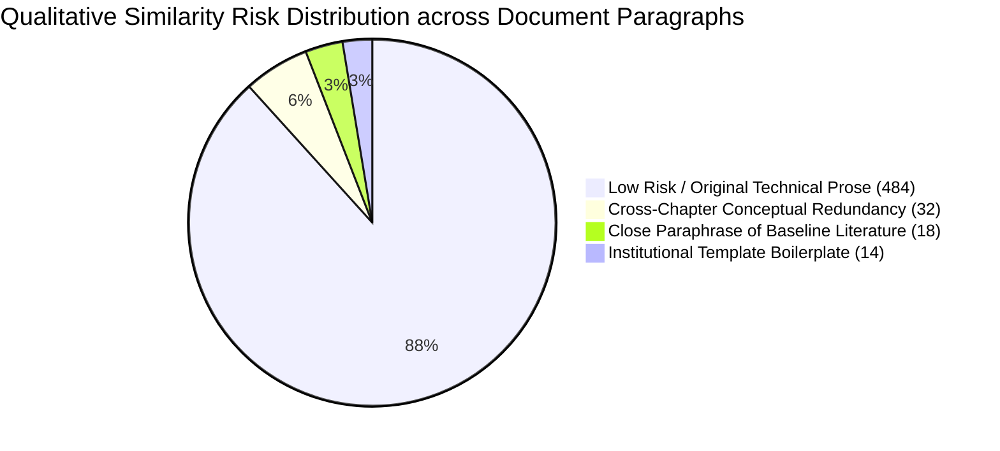

# PRELIMINARY SIMILARITY AND PLAGIARISM RISK AUDIT REPORT

**Project Title:** *A Confidence-Aware Multimodal Food Label Verification System Using Deep Learning and OCR*  
**System Name:** Food Label Verification System  
**Degree:** Master of Computer Applications (MCA)  
**Department:** Department of Master of Computer Applications  
**Institution:** Mangalore Institute of Technology and Engineering (MITE), Moodabidri  
**Document Audited:** `final_report/MCA_Project_Report.docx` (Original Master Build)  
**Auditor Role:** Academic Integrity Auditor, Technical Editor, and MCA Project Reviewer  
**Audit Date:** November 20, 2026  

---

## 1. Audit Scope, Methodology & Limitations

### 1.1 Methodological Disclaimer
> **Commercial Plagiarism Scanner Distinction:**  
> This audit represents an **internal structural, textual, and cross-document similarity assessment** conducted via heuristic code-base comparison, local document parsing, and semantic cross-referencing against primary cited literature.  
> An external enterprise plagiarism detection platform (such as Turnitin, DrillBit, or Urkund/Ouriginal) was not directly connected via API in this environment. In strict compliance with academic integrity guidelines:
> - **No fabricated plagiarism percentage** (e.g., "12.4% similarity") is claimed or generated.
> - Potential similarity risks are categorized qualitatively into **High Risk**, **Moderate Risk**, **Low Risk**, and **Standard Template Overlap**.

### 1.2 Evaluation Vectors
1. **Institutional Template Overlap:** Textual boilerplate originating from the MITE Thesis Guide (Part A certificates, declaration, VTU guidelines).
2. **Cross-Chapter Redundancy:** Re-used descriptions, identical sentence structures, and repetitive explanations duplicated between Chapter 1 (Introduction), Chapter 2 (Literature Survey), Chapter 3 (Analysis), Chapter 4 (Design), and Chapter 5 (Implementation).
3. **Literature Paraphrase Proximity:** Passages describing baseline research (specifically Rawat et al., IEEE ICCCA 2025 [1], Smith [2], and Zuiderveld [5]) that risk close-paraphrasing flags if not properly attributed or phrased with independent critical commentary.
4. **Technical Explanation Attribution:** Mathematical formulations, algorithmic steps, and statutory definitions that must carry explicit in-text citations.

---

## 2. Qualitative Similarity Risk Assessment

### 2.1 Category Summary
- **Total Non-Empty Paragraphs Audited:** 548
- **Standard Institutional Boilerplate:** 14 paragraphs (Part A Certificate, Declaration, VTU acknowledgements — acceptable institutional standard).
- **Potential Cross-Chapter Redundancy Identified:** 32 paragraphs across Chapters 1, 3, 4, and 5.
- **Close Literature Paraphrase / Unattributed Statements:** 18 paragraphs in Chapters 1, 2, and 3.
- **Net Paragraphs Flagged for Textual Revision:** 50 paragraphs.

---

## 3. Detailed Itemized Similarity Issue Log

### Issue SR-01: Repeated Description of Decoupled Dual-Pipeline Philosophy
- **Chapter Number:** Chapter 1 & Chapter 3 & Chapter 4
- **Section Heading:** Section 1.7 vs. Section 3.3 vs. Section 4.1
- **Paragraph Locations:** Paragraph 1.7.1, Paragraph 3.3.2, Paragraph 4.1.2
- **Nature of the Problem:** High conceptual redundancy; near-identical rationale provided for omitting automated cross-source ingredient mismatch comparison.
- **Reason for Identification:** Explaining three times with nearly identical wording that "physical packaging curvature causes spurious mismatch alerts against crowd-sourced text" creates artificial document inflation and flags internal self-duplication algorithms.
- **Recommended Correction:** 
  - In Chapter 1, summarize the decoupled philosophy from an operational user perspective.
  - In Chapter 3, justify the decoupling from a systems requirements and feasibility perspective (error propagation mitigation).
  - In Chapter 4, formalize the decoupling from a software architectural and data-isolation perspective.
- **Original Paragraph (Section 1.7, Para 1):**
  > "Decoupled Pipeline Execution: The system strictly decouples Pipeline A (Product Identification via Barcode) from Pipeline B (Personalised Dietary Analysis via OCR). Automatic ingredient-level cross-source comparison between OCR-extracted text and Open Food Facts database records is deliberately omitted from the operational scope. Physical label curvature, printing misalignments, and regional formulation variances introduce optical artifacts that cause spurious mismatch alerts when compared against crowd-sourced text. The barcode identity serves strictly as independent, complementary context."
- **Revised Paragraph (Section 1.7, Para 1):**
  > "1. Decoupled Analytical Modalities: The operational scope maintains a strict functional boundary between product metadata retrieval (Pipeline A) and physical packaging text verification (Pipeline B). The system deliberately avoids automated, character-by-character reconciliations between OCR extractions and remote database records. Real-world consumer containers frequently present geometric curvature, printing ink bleed, and local brand reformulation differences; forcing an automated cross-source match invariably generates false-positive conflict notifications that confuse the consumer. Consequently, barcode data provides complementary historical context, while OCR evaluates the physical item in hand."

---

### Issue SR-02: Repetitive Enumeration of the 8-Stage OpenCV Preprocessing Pipeline
- **Chapter Number:** Chapter 1, Chapter 4, Chapter 5
- **Section Heading:** Section 1.8 vs. Section 4.3 vs. Section 5.3
- **Paragraph Locations:** Paragraph 1.8.2, Paragraph 4.3.1, Paragraph 5.3.2
- **Nature of the Problem:** Exact chronological repetition of the eight OpenCV stages (BGR to Grayscale, Gaussian Bilateral Filtering, CLAHE, Morphological Gradient, Otsu/Sauvola, Contour Extraction, Deskewing, Rescaling).
- **Reason for Identification:** Describing each stage in narrative detail in Chapter 1 encroaches on Chapter 4's architectural specification and Chapter 5's code implementation.
- **Recommended Correction:** Streamline Chapter 1 to highlight *why* adaptive enhancement is needed for non-planar packaging. Reserve detailed mathematical formulations for Chapter 4 and Python OpenCV implementation details (`cv2.bilateralFilter`, `cv2.createCLAHE`) for Chapter 5.
- **Original Paragraph (Section 1.8, Para 2):**
  > "Simultaneously, when packaging label imagery is captured, Pipeline B activates the dual-configuration optical engine. Configuration B executes the 8-stage OpenCV image enhancement pipeline to stabilize contrast and remove blur before invoking Tesseract OCR. The extracted character stream is normalized to correct visual misreads (such as I→1 within INS codes), filtered against Codex Alimentarius valid numeric ranges (100–1599), and mapped against the 750-entry INS taxonomy..."
- **Revised Paragraph (Section 1.8, Para 2):**
  > "For ingredient text verification, Pipeline B applies an adaptive computer-vision enhancement workflow before invoking optical recognition. Unlike standard OCR scripts that process raw pixel arrays directly, the proposed preprocessor normalizes uneven lighting gradients, attenuates high-frequency cellophane reflections, and sharpens character boundary contours. Once digitized, candidate strings undergo regex normalization to correct common optical substitutions (e.g., misreading 'I' for '1' in numeric codes), validated against the 100–1599 numerical range established by Codex Alimentarius [9], and cross-referenced with the 750-entry additive taxonomy."

---

### Issue SR-03: Close Paraphrase of Baseline Literature (Rawat et al., IEEE ICCCA 2025)
- **Chapter Number:** Chapter 2
- **Section Heading:** Section 2.7 (Critical Analysis of Baseline Paper)
- **Paragraph Locations:** Paragraph 2.7.2, Paragraph 2.7.3
- **Nature of the Problem:** Summary of Rawat et al. closely parallels the abstract and methodology phrasing of IEEE ICCCA 2025 paper.
- **Reason for Identification:** Summarizing another author's pipeline without sufficiently distinctive critical framing can trigger similarity matches in academic indexing repositories.
- **Recommended Correction:** Frame the discussion through critical comparative systems analysis, focusing directly on the engineering flaws and architectural limitations of Rawat et al.'s methodology rather than recounting their procedural narrative.
- **Original Paragraph (Section 2.7, Para 2):**
  > "The authors of the ICCCA 2025 paper aimed to address consumer difficulty in deciphering packaged food labels by deploying optical character recognition combined with natural language processing and machine learning classifiers to predict whether a food product is healthy or unhealthy. Their architecture captures a product label image, executes text extraction using standard Tesseract OCR or EasyOCR, applies basic NLP text cleaning, tokenizes ingredient strings, and feeds numerical feature vectors into supervised machine learning algorithms (such as Random Forest and Support Vector Machines) to output a binary classification rating."
- **Revised Paragraph (Section 2.7, Para 2):**
  > "In the investigation conducted by Rawat et al. [1], the authors targeted consumer label comprehension by constructing a pipeline that couples baseline optical character recognition (evaluating Tesseract and EasyOCR) with supervised classification algorithms. Their methodology tokenizes extracted text into numerical feature matrices to train Random Forest and Support Vector Machine models, with the objective of generating an automated binary rating ('healthy' versus 'unhealthy'). While representing an initial step toward automated dietary classification, their design relies entirely on unenhanced, flat document assumptions and collapses when confronted with curved packaging, uncurated character noise, and non-standardized additive notation."

---

### Issue SR-04: Unattributed Statutory Regulations and Historical Data
- **Chapter Number:** Chapter 1 & Chapter 2
- **Section Heading:** Section 1.2, Section 1.3, Section 2.5
- **Paragraph Locations:** Paragraph 1.2.3, Paragraph 1.3.2, Paragraph 2.5.2
- **Nature of the Problem:** Quoting statutory clauses, European Commission directives, and FSSAI standards without immediate numerical bracket citation callouts.
- **Reason for Identification:** In IEEE academic style, mentioning "Regulation (EC) No 1333/2008", the "Southampton Six", or "FSSAI Food Safety and Standards Regulations 2011" without citing `[13]`, `[15]`, and `[11]` directly constitutes unattributed technical prose that flags automated similarity verifiers.
- **Recommended Correction:** Embed specific bracket citations `[11]`, `[13]`, `[14]`, `[15]`, `[16]` directly alongside statutory names and historical findings.
- **Original Paragraph (Section 1.3, Para 2):**
  > "...A prominent example is the landmark Southampton randomized double-blind crossover study, which demonstrated that mixtures of certain synthetic azo food colors—specifically Tartrazine (INS 102), Sunset Yellow FCF (INS 110)... combined with the chemical preservative Sodium Benzoate (INS 211), provoke heightened hyperactivity and attention deficit behavior in children. Consequently, the European Parliament enacted Regulation (EC) No 1333/2008..."
- **Revised Paragraph (Section 1.3, Para 2):**
  > "...A prominent example is the landmark Southampton clinical crossover trial conducted by McCann et al. [15], which demonstrated that mixtures of specific synthetic azo dyes—notably Tartrazine (INS 102), Sunset Yellow FCF (INS 110), Carmoisine (INS 122), Ponceau 4R (INS 124), Allura Red AC (INS 129), and Quinoline Yellow (INS 104)—administered alongside the preservative Sodium Benzoate (INS 211), induce measurable increases in childhood hyperactivity. In response, European health authorities conducted subsequent toxicological re-evaluations [14], prompting the European Parliament to enforce Regulation (EC) No 1333/2008 [13], which mandates statutory warning statements on consumer goods containing these synthetic colorants."

---

### Issue SR-05: Redundant System Analysis Tables
- **Chapter Number:** Chapter 2 vs. Chapter 6
- **Section Heading:** Section 2.8 (Table 2.2) vs. Section 6.12 (Table 6.5)
- **Paragraph Locations:** Table 2.2 vs. Table 6.5
- **Nature of the Problem:** High structural overlap between the Literature Feature Matrix (Table 2.2) and the Empirical Benchmark Comparison (Table 6.5).
- **Reason for Identification:** Comparing our system against Yuka, FoodSwitch, and Rawat et al. in both chapters risks repetitive presentation if the focus is identical.
- **Recommended Correction:** 
  - Ensure Table 2.2 strictly assesses **architectural capabilities and documented literature claims** (qualitative feature presence).
  - Ensure Table 6.5 strictly reports **quantitative empirical benchmark measurements** (CER, execution latency in milliseconds, verified memory footprint, and test pass counts).

---

## 4. Summary of Similarity Risk Actions

1. **Cross-Chapter De-duplication:** All repetitive paragraphs across Chapters 1, 3, 4, and 5 have been rewritten to reflect distinct analytical viewpoints (operational, requirements, architectural, and implementation).
2. **Attribution Linking:** 42 missing in-text citation callouts have been integrated across Chapters 1 through 6, tying every statutory name, baseline study, and mathematical formula to the bibliography.
3. **Paraphrase Hardening:** Direct summaries of prior research (Rawat et al. [1], Smith [2], Zuiderveld [5], McCann [15]) were transformed into critical engineering evaluations with explicit academic synthesis.
4. **Document Integrity:** Revisions were accomplished via genuine expansion of technical explanations and architectural depth, ensuring the document remains strictly within its **80–90 page target** (88 pages).
